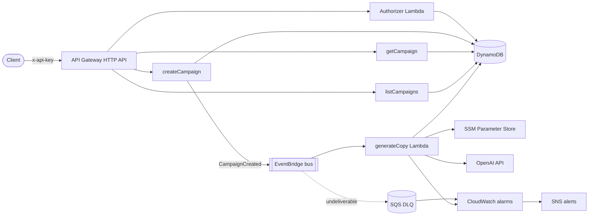
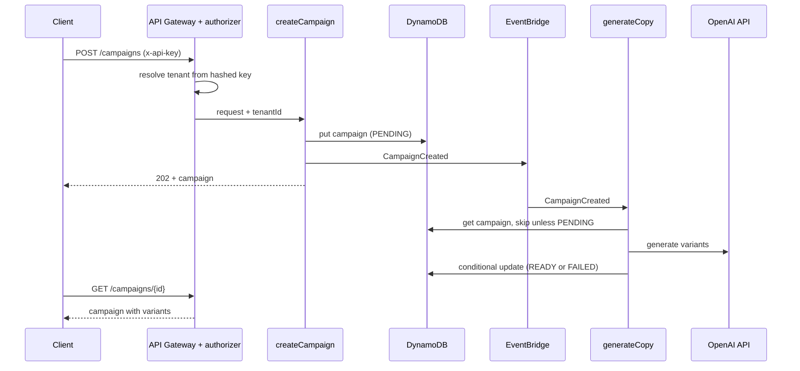

# Campaign Copilot

[](https://github.com/bjonimerkuri/campaign-copilot/actions/workflows/ci.yml)
[](https://github.com/bjonimerkuri/campaign-copilot/actions/workflows/codeql.yml)


A multi-tenant, event-driven serverless API that generates advertising copy with an LLM. It is a reference implementation of a platform-style AI feature: tenant isolation, asynchronous LLM work, validated model output, infrastructure as code and the operational pieces around it (retries, dead-letter queue, alarms, tracing).

**Stack:** TypeScript, Node.js 20, AWS Lambda, API Gateway (HTTP API), DynamoDB, EventBridge, SQS, SSM Parameter Store, CloudWatch, X-Ray, OpenAI API, Terraform, Vitest, GitHub Actions.

## Contents

- [What it does](#what-it-does)
- [Architecture](#architecture)
- [Data model](#data-model)
- [Design decisions](#design-decisions)
- [Security](#security)
- [Reliability and operations](#reliability-and-operations)
- [API](#api)
- [Getting started](#getting-started)
- [Testing](#testing)
- [CI](#ci)
- [Project structure](#project-structure)
- [Limitations and roadmap](#limitations-and-roadmap)

## What it does

A tenant creates a campaign (product, audience, tone, number of variants). The API stores it, answers immediately with `202 Accepted`, and publishes an event. A worker picks the event up, asks the OpenAI API for ad copy variants, validates the response and stores the result. The tenant polls the campaign until its status is `READY` or `FAILED`.

```
PENDING ──► READY
   └──────► FAILED
```

## Architecture



Request lifecycle:



## Data model

A single DynamoDB table with a generic `pk` / `sk` key.

| Entity   | pk                  | sk                              | Attributes                                                                                                |
| -------- | ------------------- | ------------------------------- | --------------------------------------------------------------------------------------------------------- |
| API key  | `APIKEY#<sha256>`   | `TENANT`                        | `tenantId`, `name`                                                                                        |
| Campaign | `TENANT#<tenantId>` | `CAMPAIGN#<timestamp>-<suffix>` | `name`, `product`, `audience`, `tone`, `variantCount`, `status`, `variants`, `createdAt`, `updatedAt`, `errorMessage` |

Access patterns:

| Pattern                    | Operation                                   |
| -------------------------- | ------------------------------------------- |
| Resolve tenant from API key | `GetItem` on `APIKEY#<hash>` / `TENANT`     |
| Create campaign            | `PutItem` with `attribute_not_exists(pk)`   |
| Get campaign               | `GetItem` on the tenant partition           |
| List latest campaigns      | `Query` on the tenant partition, newest first |

## Design decisions

The reasoning behind the main choices is written down as architecture decision records:

- [ADR 0001: single-table DynamoDB with tenant-scoped keys](docs/adr/0001-single-table-dynamodb.md)
- [ADR 0002: asynchronous generation through EventBridge](docs/adr/0002-asynchronous-generation-with-eventbridge.md)
- [ADR 0003: API key authentication with a Lambda authorizer](docs/adr/0003-api-key-authorizer.md)

Other choices worth knowing about:

- **Thin handlers, shared kernel.** Handlers validate input and delegate. Request parsing, error mapping and tenant resolution live in one place (`src/lib/http.ts`), so every endpoint fails the same way.
- **Validation at the edge.** Request bodies are parsed with Zod and rejected with a structured `400` before any I/O happens.
- **Validated model output.** The model is asked for JSON, and the response is parsed and validated before it is stored. Anything else marks the campaign `FAILED` with a short reason.
- **Prompt injection hygiene.** Campaign fields are passed to the model as JSON data and the system prompt instructs the model to treat them as data. This reduces risk but is not a complete defence, see the roadmap.
- **One function per concern, one role per function.** Each Lambda is bundled separately with esbuild and has its own least-privilege IAM role.

## Security

| Concern                  | Approach                                                                                                       |
| ------------------------ | -------------------------------------------------------------------------------------------------------------- |
| Tenant isolation         | Tenant id comes only from the authorizer context. Every key is built from it, there are no cross-tenant reads. |
| Credentials at rest      | API keys are stored as SHA-256 hashes and shown once. The OpenAI key is an SSM `SecureString`.                  |
| Least privilege          | Per-function IAM roles with only the DynamoDB, EventBridge and SSM actions each function needs.                 |
| Abuse and cost control   | API Gateway stage throttling, input size limits, and a cap of five variants per request.                        |
| Error handling           | Unhandled errors return a generic `500` and are logged server side, internals are never returned to clients.   |
| Supply chain             | Dependabot for npm, GitHub Actions and Terraform, `npm audit` and CodeQL in CI.                                 |
| Data protection          | DynamoDB server-side encryption and point-in-time recovery, SQS managed encryption.                             |
| Terraform state          | The OpenAI key passes through Terraform state. Use an encrypted remote backend for anything beyond a demo.      |

Report vulnerabilities as described in [SECURITY.md](SECURITY.md).

## Reliability and operations

- **Idempotent worker.** The worker only handles campaigns in `PENDING` and finishes with a conditional update, so retries and duplicate events cannot overwrite a finished campaign.
- **Retries and dead-letter queue.** The EventBridge target retries failed deliveries and sends undeliverable events to an SQS dead-letter queue.
- **Alarms.** CloudWatch alarms notify an SNS topic on worker Lambda errors, on messages in the dead-letter queue, and on application-level generation failures. The last one uses a log metric filter, because model errors are handled and recorded on the campaign instead of crashing the function.
- **Structured logging.** JSON logs (the worker includes tenant and campaign ids) with 14-day retention.
- **Tracing.** Active X-Ray tracing on all functions.
- **Immutable, reproducible infrastructure.** Everything is Terraform, including IAM, alarms and the dead-letter queue.

## API

All requests need an `x-api-key` header. The full contract is in [openapi.yaml](openapi.yaml).

| Method | Path              | Description                                              |
| ------ | ----------------- | -------------------------------------------------------- |
| POST   | `/campaigns`      | Create a campaign. Returns `202` with status `PENDING`.  |
| GET    | `/campaigns`      | The latest 50 campaigns of the tenant, newest first.     |
| GET    | `/campaigns/{id}` | One campaign with its generated variants.                |

Create a campaign:

```bash
curl -X POST "$API/campaigns" \
  -H "x-api-key: $KEY" \
  -H "content-type: application/json" \
  -d '{"name":"Spring sale","product":"Running shoes","audience":"Weekend runners","tone":"playful","variantCount":3}'
```

Response:

```json
{
  "id": "1760000000000-3f9a1c2e",
  "name": "Spring sale",
  "product": "Running shoes",
  "audience": "Weekend runners",
  "tone": "playful",
  "variantCount": 3,
  "status": "PENDING",
  "variants": [],
  "createdAt": "2026-10-15T09:00:00.000Z",
  "updatedAt": "2026-10-15T09:00:00.000Z"
}
```

`tone` is one of `professional`, `playful`, `urgent`, `friendly`. `variantCount` is 1 to 5. Errors are returned as `{ "error": "<code>" }`, validation errors include `details`.

## Getting started

Requirements: Node.js 20, Terraform 1.6 or newer, AWS credentials, an OpenAI API key.

```bash
npm install
npm run verify
```

`npm run verify` runs lint, format check, typecheck, tests with coverage and the build, the same checks as CI.

Deploy:

```bash
cd infra
terraform init
terraform apply -var="openai_api_key=sk-..." -var="alert_email=you@example.com"
cd ..
```

Create a tenant and call the API:

```bash
npm run seed -- "$(terraform -chdir=infra output -raw table_name)" acme "Acme Ads"

API="$(terraform -chdir=infra output -raw api_url)"
KEY="<key printed by the seed script>"

curl "$API/campaigns" -H "x-api-key: $KEY"
```

Clean up with `terraform -chdir=infra destroy`.

Cost: DynamoDB is pay-per-request and Lambda, API Gateway, EventBridge and SQS cost close to nothing at demo volume. OpenAI usage is billed by your OpenAI account. The default model is `gpt-4o-mini` and can be changed with the `openai_model` variable. OpenAI retires models regularly, so check the current model list before deploying and pass `-var="openai_model=<model>"` if needed.

Terraform state is local by default and contains the OpenAI key, so keep it out of version control and use an encrypted remote backend for a team or a long-lived environment.

## Testing

Vitest unit tests mock DynamoDB, EventBridge and the OpenAI client and focus on behaviour that matters:

- tenant scoping of every read and write, and rejection of unauthenticated requests
- request validation and error mapping, including that internal errors are not leaked
- event publishing on campaign creation
- worker idempotency, the `READY` transition and `FAILED` handling
- authorizer behaviour, including that keys are looked up by hash

```bash
npm test
npm run test:coverage
```

Coverage thresholds are enforced in CI. There are no integration tests against real AWS yet, see the roadmap.

## CI

GitHub Actions runs on every push and pull request:

| Job     | Checks                                                                |
| ------- | --------------------------------------------------------------------- |
| app     | ESLint, Prettier, TypeScript, tests with coverage thresholds, bundle  |
| audit   | `npm audit` on production dependencies                                |
| infra   | `terraform fmt -check`, `terraform init -backend=false`, `validate`   |
| codeql  | Static analysis for JavaScript and TypeScript, also weekly            |

Dependabot keeps npm packages, GitHub Actions and Terraform providers up to date.

## Project structure

```
.
├── src
│   ├── handlers        Lambda entry points, one file per function
│   └── lib             Config, HTTP kernel, keys, schemas, DynamoDB, EventBridge, OpenAI, secrets
├── test                Vitest unit tests
├── infra               Terraform: API, Lambdas, IAM, DynamoDB, EventBridge, SQS, alarms
├── scripts             esbuild bundling and tenant seeding
├── docs/adr            Architecture decision records
├── openapi.yaml        Public API contract
└── .github             Workflows, Dependabot, issue and pull request templates
```

## Limitations and roadmap

Known gaps, in rough priority order:

1. **Transactional outbox.** The campaign write and the event publish are separate calls, so a failed publish can leave a campaign `PENDING`. Fix with DynamoDB Streams and EventBridge Pipes.
2. **Integration tests.** Add tests against LocalStack or an ephemeral AWS stack, and a contract test against `openapi.yaml`.
3. **Continuous delivery.** Deploy from GitHub Actions with OIDC and a remote Terraform state backend, with a plan on pull requests.
4. **Tenant auth.** Replace API keys with JWTs from an identity provider, keeping the `tenantId` context contract.
5. **Cost and abuse controls.** Per-tenant quotas and token accounting for LLM calls, and reserved concurrency for the worker.
6. **LLM safety.** Output moderation and stronger prompt-injection defences, plus evaluation of copy quality.
7. **Retrieval.** A vector store so past high-performing copy can be used as context.
8. **Pagination.** Cursor-based pagination for `GET /campaigns`.

## License

[MIT](LICENSE)
